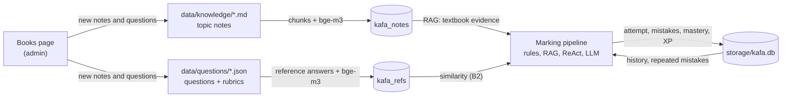

# KafAI UPKK: data stores

Generated by `scripts/describe_db.py` on 02 November 2026, from the live stores (run it again after the data changes). The system keeps its data in three places:

| Store | Technology | What it holds |
|---|---|---|
| Vector store | ChromaDB | Textbook note chunks and reference answers with their bge-m3 vectors (Section 1) |
| Pupil memory | SQLite | Pupils, every answer, repeated mistakes, mastery per topic, XP and badges (Section 2) |
| Files | Markdown, JSON, JSONL | Notes, questions, evaluation sets, books, settings, caches and logs (Section 3) |



## 1. ChromaDB: the vector store

- **Where:** `storage/chroma/` (9.5 MB), ChromaDB 1.5.9 `PersistentClient`, telemetry off.
- **Embeddings:** `BAAI/bge-m3`, computed by the app (the collections have no embedding function of their own), so the same model embeds the stored text and the search query.
- **Built by:** `python -m backend.app.kb.ingest`, which rebuilds both collections from the files and writes `storage/kb_manifest.json` (last build 2026-10-07T15:20:39+00:00, 26.8 s). New books added on the admin page are added to the same collections (`backend/app/kb/update.py`).
- **Coverage:** 48 topics; 0 of 339 chunks come from notes marked `verified` (checked by a teacher).

### `kafa_notes`

Textbook notes for retrieval (RAG). Each topic note in `data/knowledge/` is split into one chunk per `##` section; a section longer than 1500 characters is split at paragraph breaks (the last paragraph is repeated as overlap) and sections shorter than 40 characters are dropped. Each chunk starts with `Topik: <Rumi> | <Jawi>` and `Bahagian: <section>`, so it still makes sense on its own.

| Property | Value |
|---|---|
| Records | 339 |
| Per subject | fiqh 83, jawi 89, tajwid 167 |
| ID | `<topic_id>::s<section, 2 digits>p<part>` (e.g. `fiqh_b1_pengenalan::s00p0`) |
| Vector | 1024 numbers (bge-m3), supplied by the app |
| Index | HNSW, cosine distance (ef_construction 100, ef_search 100, max_neighbors 16) |
| Document length | 117–1866 characters (median 470) |

Metadata fields:

| Field | Type | Example |
|---|---|---|
| `bab` | int | `1` |
| `part` | int | `0` |
| `pdf_pages` | string | `6,7,8,9` |
| `section` | string | `Hasil Pembelajaran` |
| `source` | string | `BUKU TEKS IBADAH KAFA JAKIM TAHUN 5` |
| `subject` | string | `fiqh` |
| `topic_id` | string | `fiqh_b1_pengenalan` |
| `topic_jawi` | string | `ڤڠنالن صلاة٢ سنة` |
| `topic_rumi` | string | `Pengenalan Solat-solat Sunat` |
| `verified` | boolean | `False` |

Example record `fiqh_b1_pengenalan::s00p0` (document text, first 400 characters):

```text
Topik: Pengenalan Solat-solat Sunat | ڤڠنالن صلاة٢ سنة
Bahagian: Hasil Pembelajaran

**Rumi:** Murid dapat:
1. Menyatakan pengertian solat sunat.
2. Menghafal lafaz niat solat-solat sunat.
3. Mengetahui fadhilat solat-solat sunat.
4. Melaksanakan solat-solat sunat dengan betul.

**Jawi:** موريد داڤت:
1. مڽاتاكن ڤڠرتين صلاة سنة.
2. مڠحافل لفظ نية صلاة٢ سنة.
3. مڠتاهوءي فضيلة صلاة٢ سنة.
4. ملقساناكن…
```

### `kafa_refs`

Reference answers (Rumi + Jawi) of the questions, used by the B2 marker to measure how close a pupil's answer is to the expected answer (cosine similarity).

| Property | Value |
|---|---|
| Records | 382 |
| Per subject | fiqh 113, jawi 113, tajwid 156 |
| ID | the question id (e.g. `fiqh_b1_latihan_q1`) |
| Vector | 1024 numbers (bge-m3), supplied by the app |
| Index | HNSW, cosine distance (ef_construction 100, ef_search 100, max_neighbors 16) |
| Document length | 5–978 characters (median 75) |

Metadata fields:

| Field | Type | Example |
|---|---|---|
| `level` | int | `1` |
| `max_marks` | int | `1` |
| `question_id` | string | `fiqh_b1_latihan_q1` |
| `subject` | string | `fiqh` |
| `topic_id` | string | `fiqh_b1_solat_rawatib` |

Example record `fiqh_b1_latihan_q1` (document text, first 400 characters):

```text
Sebelum
سبلوم
```

## 2. SQLite: the pupil learning memory

- **Where:** `storage/kafa.db` (308.0 KB), Python's built-in `sqlite3` (`backend/app/memory/db.py`); the tables are created on first use.
- **Privacy:** this document shows the structure and the number of rows only, never pupils' names or answers.
- **Rules kept in the memory:**
  - Mastery per topic is a moving average of the percent score: the first answer sets it, then mastery = 0.7 × old + 0.3 × new.
  - The next Tahap opens after at least 3 answers at the current Tahap with an average of at least 70% over the last 3 (up to Tahap 3).
  - A criterion missed 2 or more times in a topic is a repeated mistake; the feedback then warns the pupil.
  - XP = 10 per star + 2 for trying; the streak counts days in a row with at least one answer.

```mermaid
erDiagram
  students {
    INTEGER id PK
    TEXT name
    TEXT kelas
    TEXT avatar
    TEXT script_pref
    TEXT created_at
  }
  attempts {
    INTEGER id PK
    INTEGER student_id FK
    TEXT question_id
    TEXT topic_id
    TEXT subject
    INTEGER level
    TEXT answer
    REAL score
    REAL max_marks
    REAL percent
    TEXT criteria_json
    TEXT feedback_json
    TEXT react_trace_json
    INTEGER latency_ms
    TEXT created_at
  }
  mistakes {
    INTEGER student_id PK FK
    TEXT topic_id PK
    TEXT criterion PK
    INTEGER count
    TEXT last_seen
  }
  topic_mastery {
    INTEGER student_id PK FK
    TEXT topic_id PK
    TEXT subject
    REAL mastery
    INTEGER attempts
    INTEGER level_unlocked
    TEXT updated_at
  }
  progress {
    INTEGER student_id PK FK
    INTEGER xp
    INTEGER streak_days
    TEXT last_active_date
    TEXT badges_json
  }
  students ||--o{ attempts : "answers"
  students ||--o{ mistakes : "misses"
  students ||--o{ topic_mastery : "learns"
  students ||--|| progress : "earns"
```

### `students` (9 rows)

| Column | Type | Rule | Meaning |
|---|---|---|---|
| `id` | INTEGER | primary key | Pupil number |
| `name` | TEXT | not null | Name typed at sign-in |
| `kelas` | TEXT | not null, default '' | Class, e.g. 5 Bestari |
| `avatar` | TEXT | not null, default '' | Chosen animal emoji |
| `script_pref` | TEXT | not null, default 'rumi' | Preferred script (rumi / jawi) |
| `created_at` | TEXT | not null | First sign-in (UTC, ISO 8601) |

`(name, kelas)` is unique: signing in again with the same name and class returns the same pupil.

### `attempts` (58 rows)

| Column | Type | Rule | Meaning |
|---|---|---|---|
| `id` | INTEGER | primary key | Attempt number |
| `student_id` | INTEGER | not null | → students.id |
| `question_id` | TEXT | not null | Question id (data/questions) |
| `topic_id` | TEXT | not null | Topic id (note file name) |
| `subject` | TEXT | not null | fiqh / jawi / tajwid |
| `level` | INTEGER | not null | Tahap 1–3 |
| `answer` | TEXT | not null | The pupil's answer text |
| `score` | REAL | not null | Marks given |
| `max_marks` | REAL | not null | Marks available |
| `percent` | REAL | not null | score / max_marks × 100 |
| `criteria_json` | TEXT | not null | Per-criterion result (below) |
| `feedback_json` | TEXT | not null | The feedback shown to the pupil (below) |
| `react_trace_json` | TEXT | not null | The ReAct steps (below) |
| `latency_ms` | INTEGER | not null | Marking time |
| `created_at` | TEXT | not null | When answered (UTC) |

Index: `ix_attempts_student_topic`.

### `mistakes` (23 rows)

| Column | Type | Rule | Meaning |
|---|---|---|---|
| `student_id` | INTEGER | primary key | → students.id |
| `topic_id` | TEXT | primary key | Topic id |
| `criterion` | TEXT | primary key | Rubric criterion not met |
| `count` | INTEGER | not null, default 0 | Times missed |
| `last_seen` | TEXT | not null | Last time missed (UTC) |

### `topic_mastery` (11 rows)

| Column | Type | Rule | Meaning |
|---|---|---|---|
| `student_id` | INTEGER | primary key | → students.id |
| `topic_id` | TEXT | primary key | Topic id |
| `subject` | TEXT | not null | fiqh / jawi / tajwid |
| `mastery` | REAL | not null | 0–1, moving average of the scores |
| `attempts` | INTEGER | not null | Answers in this topic |
| `level_unlocked` | INTEGER | not null, default 1 | Highest open Tahap (1–3) |
| `updated_at` | TEXT | not null | Last change (UTC) |

### `progress` (9 rows)

| Column | Type | Rule | Meaning |
|---|---|---|---|
| `student_id` | INTEGER | primary key | → students.id |
| `xp` | INTEGER | not null, default 0 | Experience points |
| `streak_days` | INTEGER | not null, default 0 | Days in a row with an answer |
| `last_active_date` | TEXT | – | Last day with an answer (local date) |
| `badges_json` | TEXT | not null, default '[]' | Badge ids earned (list) |

### JSON stored in `attempts` (field names only)

- `criteria_json`: a list, one object per rubric criterion: `criterion`, `marks`, `awarded`, `met`, `layer`, `evidence`, `similarity`, `overlap`, `llm_raw`, `llm_reason`, `llm_verdict`, `llm_probs`.
- `feedback_json`: `score`, `max_marks`, `percent`, `stars`, `xp_gained`, `verdict`, `mistakes`, `correct_answer`, `source`, `repeated`, `suggestion`, `encouragement`, `mastery`, `level`.
- `react_trace_json`: a list of ReAct steps: `step`, `thought`, `action`, `action_input`, `observation`, `ms`.

## 3. Files

| What | Where | Content |
|---|---|---|
| Topic notes | `data/knowledge/<subject>/*.md` (48) | Markdown with a YAML header: `id`, `subject`, `year`, `bab`, `bab_rumi`, `bab_jawi`, `topic_rumi`, `topic_jawi`, `source`, `pdf_pages`, `book_pages`, `verified`. The source of `kafa_notes`. |
| Questions | `data/questions/<subject>/*.json` (49 files, 382 questions) | One file per topic: `topic_id`, `subject`, `questions`. A question has `id`, `level`, `type`, `origin`, `related_topic_id`, `question_rumi`, `question_jawi`, `reference_answer_rumi`, `reference_answer_jawi`, `rubric`, `max_marks`, `source_pages`; each rubric criterion has `criterion`, `marks`, `keywords`. The source of `kafa_refs`. |
| Multiple-choice versions | `data/mcq/<subject>.json` (268 questions) | The A–D version of a question, keyed by question id: `stem_rumi`, `stem_jawi`, `options`, `answer`, `explanation_rumi`, `spelling`, and who generated and checked it. |
| Train / test split | `data/splits/train.json`, `test.json` | The question ids in each split (306 / 76), with the seed, test ratio and stratification used. |
| Evaluation sets | `data/silver/`, `data/teacher/` | Silver answers (AI-written paraphrases and programmatic answers) and the 50-answer teacher set with the teachers' marks. |
| Fine-tuning data | `data/finetune/kafa_marker_sft.jsonl` (578 lines) | One chat example per line: `id`, `split`, `subject`, `kind`, `messages` (Phase 4). |
| Books & syllabus | `storage/books/<book_id>/book.json` (3) | Fields `id`, `title`, `subject`, `kind`, `year`, `origin`, `status`, `created`, `pages`, `cost`, `files`, `updated`; an uploaded book also keeps its PDF, page images and drafts there. |
| Knowledge-base manifest | `storage/kb_manifest.json` | When the vector store was last built, with which model, and its counts. |
| Runtime settings | `storage/runtime_settings.json` | Settings changed on the admin page while the system runs: `qwen_endpoint`, `qwen_key` (the Colab key is a secret and is not shown here). |
| LLM answer cache | `storage/llm_cache/` (5589 files, 2.5 MB) | One JSON file per (model, prompt): the same request is never paid twice. |
| LLM call log | `storage/llm_calls.jsonl` (10946 lines) | One line per call: `ts`, `model`, `tag`, `tokens_in`, `tokens_out`, `cost`, `ms`, `ok`, `cached`. |
| Experiment results | `eval/results/` | Every run, table and statistic in the report (JSON and Markdown). |
| Secrets | `.env`, `storage/admin_secret` | The OpenRouter API key, the admin password and the key that signs admin sessions. Git-ignored; never shown or committed. |

`storage/` and `.env` are git-ignored: they hold pupil data, secrets and caches that are rebuilt or re-created on another machine.
